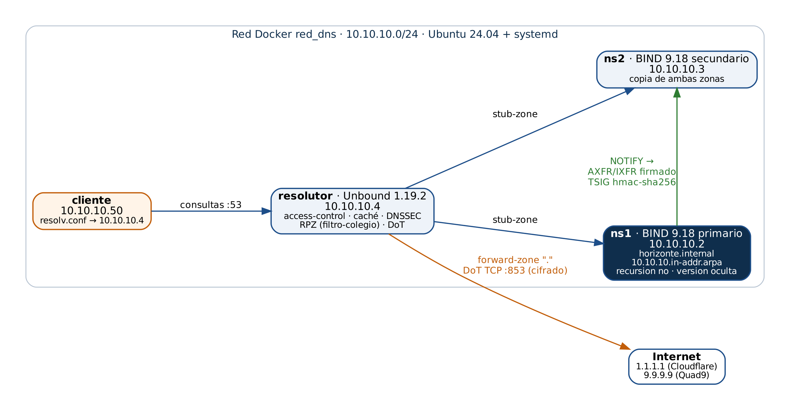

# Actividad 02 — DNS moderno con BIND9

**Tecnología Web I (SIS-0150) · Universidad Privada Domingo Savio (UPDS) · Semestre 2/2026**
Docente: M.Sc. Ing. Jimmy Nataniel Requena Llorentty · Grupo **Sin Hosting**:
Jacqueline Cáceres · Lucas Carrasco · José María Orihuela · Juniors Parapaino · Limber Quispe · Lizeth Rodríguez

DNS autoritativo del dominio de laboratorio `horizonte.internal` (U.E. Horizonte) con BIND9, servidor
secundario con transferencia restringida por TSIG, resolutor propio con Unbound y un cliente configurado
para usar el DNS propio. Todo en una red Docker con cuatro nodos Ubuntu 24.04.



| Laboratorio | Qué se hizo | Verificador |
|---|---|---|
| [Lab 6](lab06/HOJA_TRABAJO.md) | Resoluciones reales con `dig +trace`, tipos de registro, TTL y caché, radiografía DNS de dominios bolivianos y [diagrama de la jerarquía](evidencias/diagramas/jerarquia.png) | **12 de 12** |
| [Lab 7](lab07/HOJA_TRABAJO.md) | BIND9 primario (ns1) y secundario (ns2): zona directa e inversa, `named-checkconf` / `named-checkzone`, TSIG, NOTIFY y serial | **16 de 16** |
| [Lab 8](lab08/HOJA_TRABAJO.md) | Resolutor Unbound (stub-zones, DNSSEC, DoT, RPZ, caché), cliente usando el DNS propio y zona pública como código con DNSControl | **17 de 17** |

- **Informe técnico (APA 7):** [informe/](informe/) — `Informe_Tecnico_Actividad02_DNS_Grupo_Sin_Hosting.docx` / `.pdf`
- **Presentación:** [presentacion/](presentacion/) — `.pptx` y `.pdf`
- **Bitácoras de IA:** [lab06](lab06/BITACORA_IA.md) · [lab07](lab07/BITACORA_IA.md) · [lab08](lab08/BITACORA_IA.md) (la consolidada está en el informe)

## Red de laboratorio

| Nodo | IP | Función |
|---|---|---|
| ns1 | 10.10.10.2 | BIND 9.18 primario de `horizonte.internal` y `10.10.10.in-addr.arpa` |
| ns2 | 10.10.10.3 | BIND 9.18 secundario (copia con TSIG) |
| resolutor | 10.10.10.4 | Unbound 1.19.2 + DNSControl 5.2.0 |
| cliente | 10.10.10.50 | `/etc/resolv.conf` → `nameserver 10.10.10.4` |

```powershell
cd red_dns
docker compose up -d --build                         # la carpeta de arriba se monta como /lab
docker compose exec ns1 bash /lab/lab07/instalar_ns1.sh
docker compose exec ns2 bash /lab/lab07/instalar_ns2.sh
docker compose exec cliente bash /lab/lab07/verificar_lab07.sh     # 16 de 16
docker compose exec resolutor bash /lab/lab08/instalar_resolutor.sh
docker compose exec resolutor bash /lab/lab08/verificar_lab08.sh   # 17 de 17
```

## Estructura

```
.
├── README.md
├── .gitignore            # excluye transferencia.key, creds.reales.json y *.pcap
├── red_dns/              # compose.yaml + Dockerfile de la red 10.10.10.0/24
├── lab06/                # radiografia_dns.sh, hoja de trabajo y bitácora
├── lab07/                # ns1/ y ns2/ (zonas y named.conf.*), scripts, hoja y bitácora
├── lab08/                # unbound/, dns-como-codigo/, scripts, hoja y bitácora
├── evidencias/           # capturas por laboratorio y diagramas
├── informe/              # informe técnico grupal y de cada laboratorio
└── presentacion/         # presentación de la actividad
```

## Seguridad
- La clave TSIG (`lab07/compartido/transferencia.key`) **no** está en el repositorio: la genera `instalar_ns1.sh`.
- `lab08/dns-como-codigo/creds.json` solo usa el proveedor `bind` local. Para un proveedor real (Cloudflare)
  el token se lee de una variable de entorno (`"apitoken": "$CLOUDFLARE_APITOKEN"`), nunca escrito en el archivo.
- El resolutor solo acepta consultas de `127.0.0.0/8` y `10.10.10.0/24`.
